# Traffic Accident Severity Analytics and MLOps: System Architecture

This document outlines the multi-tiered architecture for the end-to-end Data Engineering (Part 1) and MLOps Pipeline Extension (Part 2).

---

## 1. End-to-End System Architecture Diagram

```mermaid
flowchart TD
    subgraph S1["1. Data Source Layer"]
        A1["UK Department for Transport (DfT)<br/>2025 Collisions, Vehicles, Casualties"]
        A2["Open-Meteo Historical Archive API<br/>Atmospheric Weather Observations"]
    end

    subgraph S2["2. Ingestion & Raw Landing Layer"]
        B1["data/raw/uk_2025/collisions.csv"]
        B2["data/raw/uk_2025/vehicles.csv"]
        B3["data/raw/uk_2025/casualties.csv"]
        B4["scripts/pipeline.py<br/>(Stream reader & entity merger)"]
    end

    subgraph S3["3. Validation & Staging Layer"]
        C1["Data Quality Gate<br/>(GPS bounds, ISO dates, uniqueness)"]
        C2[("data/output/rejected_records.csv<br/>[Quarantine Audit Log]")]
        C3[("data/output/accidents_cleaned.csv<br/>[101,523 Clean Records]")]
    end

    subgraph S4["4. Meteorological Enrichment Layer"]
        D1["scripts/weather_enrichment.py<br/>(WMO weather code mapping)"]
        D2[("data/output/weather_cache.json<br/>[Local Request Cache]")]
        D3[("data/output/accidents_enriched.csv<br/>[Telemetry Joined]")]
    end

    subgraph S5["5. Storage & Dimensional Warehouse Layer"]
        E0["scripts/load_db.py<br/>(Batch loader & dimension mapper)"]
        E1[("PostgreSQL / PostGIS Warehouse<br/>(Docker port 5432)")]
        E2[("SQLite Embedded Warehouse<br/>data/traffic_accidents.db")]
        E3["Star Schema Tables<br/>dim_date, dim_location, dim_road,<br/>dim_weather, dim_severity, fact_accident"]
        E4[("accident_analytics<br/>[Serving Data Mart]")]
    end

    subgraph S6["6. Analytics & BI Layer"]
        F1["app.py<br/>[Streamlit Interactive Dashboard]"]
        F2["5 Core Analytical Views<br/>(Temporal, Hotspots, Weather, Casualties, Mart)"]
    end

    subgraph S7["7. MLOps Training & Registry Layer (Part 2)"]
        G1["src/features.py<br/>(Chronological Train/Val/Test Split & ColumnTransformer)"]
        G2["src/train.py<br/>(Balanced Class Weighting & Multi-Model Training)"]
        G3["Candidate Models<br/>- Baseline Logistic Regression<br/>- Balanced Random Forest<br/>- Balanced XGBoost"]
        G4[("MLflow Tracking & Artifact Store<br/>mlruns / sqlite:///data/mlflow.db")]
        G5[("MLflow Model Registry<br/>'traffic_accident_severity_model' v1.0.0")]
        G6[("models/accident_severity_pipeline.joblib<br/>[Unified Inference Artifact]")]
    end

    subgraph S8["8. Serving & Inference Layer"]
        H1["FastAPI Microservice (src/api.py)<br/>Docker port 8000 (/docs)"]
        H2["Streamlit View 6: Real-Time Predictor<br/>(Interactive Risk Gauge & Alerting)"]
        H3["Batch & Streaming REST Endpoints<br/>POST /predict, POST /predict/batch"]
    end

    subgraph S9["9. Continuous Monitoring & Retraining Feedback Loop"]
        I1["src/monitoring.py<br/>- Class Drift (PSI)<br/>- Location Centroid Drift<br/>- Data Quality Audit<br/>- False-Negative Rate (FNR)"]
        I2{"Retraining Gate Triggered?<br/>(PSI >= 0.20 or Fatal FNR >= 0.60)"}
        I3["dags/mlops_pipeline_dag.py<br/>(Automated Airflow Retraining Orchestration)"]
    end

    %% Data Flow Connections
    A1 --> B1 & B2 & B3
    A2 --> D1
    B1 & B2 & B3 --> B4
    B4 --> C1
    C1 -->|Invalid Rows| C2
    C1 -->|Accepted Rows| C3
    C3 --> D1
    D1 <--> D2
    D1 --> D3
    D3 --> E0
    E0 --> E1 & E2
    E1 & E2 --> E3 --> E4
    E4 --> F1 --> F2
    E4 --> G1
    G1 --> G2 --> G3
    G3 --> G4 --> G5 --> G6
    G6 --> H1 & H2
    H1 --> I1
    H2 --> I1
    I1 --> I2
    I2 -->|Yes: Trigger Retrain| I3
    I3 --> G2
    I2 -->|No: Operational Stable| H1
```

---

## 2. Layer-by-Layer Architectural Breakdown

### 1. Data Source Layer
- **UK Road Safety Open Data (DfT)**: Public collisions, vehicles, and casualties records for 2025.
- **Open-Meteo Historical Archive API**: Atmospheric variables including temperature, precipitation, snowfall, and wind speed.

### 2. Ingestion & Raw Landing Layer
- Raw landing under `data/raw/uk_2025/` is immutable and never modified in place.
- Extraction scripts record row counts, execution time, and file status.

### 3. Validation & Staging Layer
- Enforces strict data-quality rules: WGS84 UK boundaries ($49.0 \le \text{Lat} \le 61.5$, $-8.5 \le \text{Lon} \le 2.5$), deduplication of accident indices, and non-null collision severities.
- Non-compliant rows are quarantined with descriptive rejection reasons to `data/output/rejected_records.csv`.

### 4. Transformation & Weather Enrichment Layer
- Standardizes date strings into ISO format (`YYYY-MM-DD`), derives collision hour ($0-23$) and day-of-week.
- Maps WMO codes to human-readable weather descriptions and caches API responses under `data/output/weather_cache.json`.

### 5. Storage & Warehouse Layer
- Implements a Kimball Star Schema:
  - `dim_date`: Calendar dimension (day, month, year, day of week, is_weekend).
  - `dim_location`: Administrative authority, latitude, longitude.
  - `dim_road`: Road layout, posted speed limit, lighting, surface moisture.
  - `dim_weather`: Temperature, precipitation, wind speed, atmospheric conditions.
  - `dim_severity`: Controlled severity taxonomy (`Fatal`, `Serious`, `Slight`).
  - `fact_accident`: Collision grain linking all 5 dimensions with vehicle and casualty metrics.
  - `accident_analytics`: Flattened data mart for sub-second dashboard performance.
- Dual-warehouse support: Automatic fallback to embedded SQLite (`data/traffic_accidents.db`) or PostgreSQL (`schema.sql`).

### 6. Analytics & Dashboard Layer
- Interactive white-theme Streamlit application (`app.py`) providing:
  1. Severity & Temporal Patterns
  2. Location Hotspot Map
  3. Weather & Road Conditions
  4. Vehicle & Casualty Analysis
  5. Analytical Mart Explorer

### 7. MLOps Pipeline Layer (Part 2)
- **Chronological Split**: 70% Train, 15% Validation, 15% Test sorted by collision timestamp to prevent lookahead bias.
- **Class Imbalance Mitigation**: Balanced weighting ($w_c = \frac{N}{K \cdot N_c}$) giving higher weight to minority `Fatal` (~1.4%) and `Serious` (~24.8%) classes.
- **Multi-Model Benchmark**: Evaluates Baseline Logistic Regression, Balanced Random Forest, and Balanced XGBoost.
- **Experiment Tracking**: MLflow tracking parameters, macro-F1, per-class recall, false-negative rates, and confusion matrix artifacts.
- **Model Registry**: Champion model registered as `traffic_accident_severity_model` and exported to `models/accident_severity_pipeline.joblib`.

### 8. Serving & Inference Layer
- **FastAPI Microservice** (`src/api.py`): Real-time REST endpoints (`POST /predict`, `POST /predict/batch`, `GET /health`, `GET /monitoring/metrics`).
- **Streamlit View 6**: Integrated interactive collision risk predictor with real-time probability distributions and emergency risk alert banners.

### 9. Continuous Monitoring & Retraining Loop
- **Population Stability Index (PSI)**: Monitors drift between inference predictions and training baseline.
- **Location Drift**: Computes spatial centroid drift in kilometers.
- **False-Negative Rate (FNR)**: Audits safety-critical misclassifications on fatal accidents.
- **Orchestrated Retraining**: `dags/mlops_pipeline_dag.py` executes weekly retraining and model registration when drift or performance degradation triggers are tripped.
