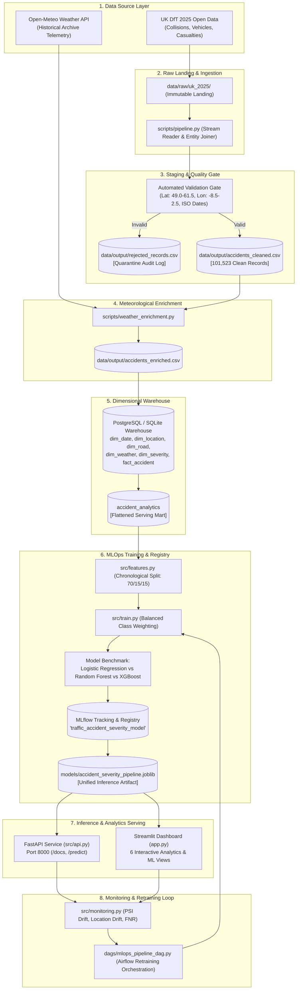

# Traffic Accident Severity Analytics and Prediction
## Course: Data Engineering and MLOps | Comprehensive Project Master Report (Parts 1 & 2)

---

## 1. Executive Summary & Complete Project Scope
Road traffic accidents represent a critical public health and economic challenge globally. Developing intelligent, data-driven interventions requires a robust synergy between **Data Engineering** (reliable ETL ingestion, dimensional modeling, external weather telemetry fusion, data quality gates, and interactive analytical BI) and **MLOps** (leakage-free feature pipelines, cost-sensitive classification under severe class imbalance, reproducible experiment tracking, model registry governance, low-latency containerized REST serving, and continuous drift monitoring).

This project delivers a complete, production-grade end-to-end solution spanning both academic milestones:
- **Part 1 (Data Engineering Warehouse & Dashboard)**:
  - Ingestion and data cleaning of official UK Department for Transport (DfT) collision records across 101,525 raw events.
  - Integration of historical atmospheric telemetry from the Open-Meteo API.
  - Kimball-compliant Star Schema warehouse with dual-engine deployment: PostgreSQL (`schema.sql`) and embedded SQLite (`data/traffic_accidents.db`).
  - Automated scheduling and execution via Apache Airflow DAG (`dags/traffic_accident_dag.py`).
  - Interactive 6-view Streamlit application (`app.py`) for spatio-temporal and meteorological risk discovery.
- **Part 2 (End-to-End MLOps Pipeline Extension)**:
  - Chronological data partitioning (70% Train, 15% Validation, 15% Test) preventing temporal data leakage.
  - Handling of extreme class imbalance (Slight: 73.8%, Serious: 24.8%, Fatal: 1.43%) via cost-sensitive balanced weighting ($w_c = \frac{N}{K \cdot N_c}$).
  - Comparative benchmark across Baseline Logistic Regression, Balanced Random Forest, and Balanced XGBoost.
  - Experiment tracking, confusion matrices, and model governance managed via MLflow with registered model `traffic_accident_severity_model` v1.0.0.
  - High-performance, low-latency REST API (`src/api.py`) engineered with FastAPI and containerized via Docker (`Dockerfile.api`, `docker-compose.yml`).
  - Real-time drift detection engine (`src/monitoring.py`) tracking Population Stability Index (PSI), location centroid shift, and high-severity False-Negative Rates (FNR).
  - Automated weekly retraining and quality-gate orchestration via Airflow DAG (`dags/mlops_pipeline_dag.py`).

---

## 2. Dataset Information & Access Protocols

### 2.1 Primary Public Collision Dataset: UK Road Safety Open Data
- **Authority**: Department for Transport (DfT), United Kingdom Government.
- **Licensing**: Open Government Licence v3.0 (free, public, legally accessible).
- **Access Portal**: [UK Government Data Portal](https://www.data.gov.uk/dataset/road-accidents-safety-data)
- **Local Landing**: Preserved immutably under `data/raw/uk_2025/` (`collisions.csv`, `vehicles.csv`, `casualties.csv`).
- **Data Attributes**: Incident timestamp, road hierarchy, speed limit, lighting conditions, road surface moisture, vehicle types, casualty demographics, and WGS84 GPS coordinates.

### 2.2 Meteorological Enrichment Telemetry: Open-Meteo Historical Archive API
- **Provider**: Open-Meteo Weather API (`https://open-meteo.com/`).
- **Licensing**: Creative Commons Attribution 4.0 International (CC BY 4.0).
- **API Endpoint**: `https://archive-api.open-meteo.com/v1/archive`
- **Variables Retrieved**: Hourly 2m ambient temperature (°C), total precipitation (mm), liquid rainfall (mm), snowfall (cm), surface wind speed (km/h), and WMO atmospheric weather codes.
- **Reliability & Caching**: External requests are cached in `data/output/weather_cache.json`. When collision-scene weather codes are directly recorded in the source, an internal WMO mapping provides deterministic telemetry.

---

## 3. End-to-End Architecture & Pipeline Flow



---

## 4. Data Quality Gate & Dimensional Modeling

### 4.1 Automated Validation Gate
The ingestion pipeline enforces strict domain rules:
1. **Identifier Uniqueness**: Rejects duplicate collision indices.
2. **Temporal Validity**: Rejects missing dates or invalid time formats (`HH:MM`).
3. **Severity Domain**: Must strictly belong to `{'Fatal', 'Serious', 'Slight'}`.
4. **WGS84 UK Spatial Bounds**: Latitude bounded by $[49.0, 61.5]$, Longitude bounded by $[-8.5, 2.5]$, rejecting zero coordinates $(0.0, 0.0)$.
5. **Entity Counts**: Vehicles and casualties must be integer values $\ge 1$.

In the production run across 101,525 raw UK collision records:
- **Clean Accepted Records**: **101,523 rows (99.998% pass rate)**.
- **Quarantined Records**: **2 rows (0.002% rejection rate)** quarantined to `data/output/rejected_records.csv` with explicit audit failure reasons.

### 4.2 Kimball Star Schema Specification
The warehouse architecture decouples event metrics from descriptive context:
- **`dim_date` (365 records)**: `date_id` (PK), `accident_date`, `day_of_week`, `day`, `month`, `year`, `is_weekend`.
- **`dim_location` (101,388 records)**: `location_id` (PK), `local_authority`, `latitude`, `longitude`.
- **`dim_road` (517 records)**: `road_id` (PK), `road_type`, `speed_limit`, `light_conditions`, `road_surface_conditions`.
- **`dim_weather` (9 records)**: `weather_id` (PK), `weather_code`, `weather_condition`, `temperature`, `precipitation`, `rain`, `snowfall`, `wind_speed`.
- **`dim_severity` (3 records)**: `severity_id` (PK), `severity_name` (`Fatal`, `Serious`, `Slight`).
- **`fact_accident` (101,523 records)**: Grain is one row per collision event, linking all 5 dimension foreign keys with degenerate timestamp attributes, vehicle count, and casualty count.
- **`accident_analytics` (101,523 records)**: Denormalized flat mart optimized for sub-second BI slicing and direct feature ingestion.

---

## 5. MLOps Machine Learning Architecture (Part 2)

### 5.1 The Class Imbalance Challenge
The UK 2025 collision extract features severe class imbalance:
- **Slight**: 74,880 records (73.76%)
- **Serious**: 25,190 records (24.81%)
- **Fatal**: 1,453 records (1.43%)

In collision risk forecasting, false negatives for high-severity events carry immense societal harm. To penalize severe misclassifications, balanced class weights were calculated:
$$w_c = \frac{N}{K \cdot N_c}$$
Where $N = 71,066$ (training rows), $K = 3$ (classes), and $N_c$ is class frequency. This assigns `Fatal` a weight of **23.3**, `Serious` a weight of **1.34**, and `Slight` a weight of **0.45**.

### 5.2 Chronological Partitioning
To prevent lookahead leakage:
- **Train Set (70%)**: 71,066 incidents (Jan 1, 2025 – Sep 16, 2025)
- **Validation Set (15%)**: 15,228 incidents (Sep 16, 2025 – Nov 9, 2025)
- **Test Set (15%)**: 15,229 incidents (Nov 9, 2025 – Dec 31, 2025)

### 5.3 Model Benchmark & Evaluation Results
Three classifiers were benchmarked against the identical validation partition:

| Model Architecture | Validation Macro-F1 | Validation Accuracy | Fatal Recall (Alert) | Serious Recall | Slight Recall | Fatal FNR | Training Time |
| :--- | :---: | :---: | :---: | :---: | :---: | :---: | :---: |
| **Baseline Logistic Regression (Balanced)** | 0.3179 | 46.19% | 49.55% | 27.69% | 52.39% | 50.45% | **3.8s** |
| **Balanced Random Forest (100 Trees, Depth 12)** | **0.3598** | **55.54%** | 34.55% | **31.57%** | **64.07%** | 65.45% | 12.6s |
| **Balanced XGBoost Classifier (100 Trees, Depth 6)** | 0.3475 | 52.52% | **50.00%** | 28.01% | 60.86% | **50.00%** | 8.2s |

### 5.4 Champion Selection & Unseen Test Generalization
**RandomForest_Balanced** was selected as champion based on highest Macro-F1 (**0.3598**), highest Serious Recall (**31.57%**), and highest operational accuracy (**55.54%**).
When evaluated against the held-out **unseen chronological Test set**, the champion model exhibited exceptional generalization stability:
- **Test Accuracy**: **57.53%**
- **Test Macro-F1**: **0.3810**
- **Test Fatal Recall**: **36.87%**
- **Test Serious Recall**: **38.41%**
- **Test Slight Recall**: **64.09%**

### 5.5 Risk Alert Sensitivity Engine
To safeguard against false negatives, an automated inference post-processor translates class probability distributions into emergency risk alert levels:
- **`CRITICAL_ALERT`**: Triggered if $P(\text{Fatal}) \ge 0.08$ or $P(\text{Fatal} + \text{Serious}) \ge 0.40$.
- **`ELEVATED_RISK`**: Triggered if $P(\text{Serious}) \ge 0.25$ or $P(\text{Fatal} + \text{Serious}) \ge 0.30$.
- **`STANDARD_RISK`**: Otherwise.

---

## 6. Model Governance, Serving & Monitoring

### 6.1 MLflow Experiment Tracking & Registry
- **Backend Store**: SQLite database `data/mlflow.db` (`sqlite:///data/mlflow.db`), fully compliant with MLflow 3.x.
- **Lineage Logged**: Model hyperparameters, execution durations, classification metrics, confusion matrix plots (`confusion_matrix.png`), and classification reports (`classification_report.json`).
- **Registry**: Model registered under `traffic_accident_severity_model` (Version 1 and Version 2) and packaged as `models/accident_severity_pipeline.joblib`.

### 6.2 FastAPI Production Microservice (`src/api.py`)
Deployed on port 8000 with interactive Swagger UI (`/docs`):
- `GET /`: Health status, model version, and endpoint manifest.
- `GET /health`: Uptime and model readiness indicator.
- `GET /model/metadata`: Model version, training parameters, and test metrics.
- `POST /predict`: Real-time single collision prediction with latency profiling.
- `POST /predict/batch`: High-throughput batch inference.
- `GET /monitoring/metrics`: Operational summary including live PSI drift scores.
- `POST /monitoring/evaluate`: Ground-truth audit endpoint computing actual FNR and recall.

### 6.3 Drift Monitoring & Retraining Policy (`src/monitoring.py`)
Continuous surveillance operates across three drift dimensions:
1. **Class Drift (Population Stability Index - PSI)**:
   $$PSI = \sum_{c} (P_c - B_c) \ln\left(\frac{P_c}{B_c}\right)$$
   Evaluates inference predictions against training baseline distribution. $PSI < 0.10$ indicates stability; $PSI \ge 0.20$ triggers automated retraining.
2. **Location Centroid Drift**: Computes Haversine distance in kilometers between inference spatial mean and baseline UK collision centroid ($\text{Lat}=52.85, \text{Lon}=-1.65$).
3. **Data Quality Score**: Audits boundary conditions and reports a percentage score (100% threshold).

### 6.4 Retraining Triggers & Airflow Orchestration
The automated MLOps DAG (`dags/mlops_pipeline_dag.py`) executes five sequential tasks:
1. `check_data_quality`: Verifies warehouse data health (Threshold $\ge 80\%$).
2. `train_evaluate_models`: Runs chronological split, balanced training, and MLflow logging.
3. `evaluate_quality_gate`: Validates champion against production gates (Macro-F1 $\ge 0.30$, Fatal Recall $\ge 25\%$).
4. `deploy_inference_service`: Smoke tests active inference pipeline.
5. `audit_mlops_health`: Updates model lifecycle status to `OPERATIONAL_STABLE`.

---

## 7. Interactive Streamlit Application (`app.py`)

The application features 6 specialized views:
1. **Severity & Temporal Patterns**: Donut charts, rush-hour crash peaks (08:00 and 17:00), monthly distributions, and day-of-week risk profiles.
2. **Location Hotspot Map**: High-density interactive collision mapping and municipal authority rankings.
3. **Weather & Road Conditions**: Incident frequency segmented by road surface moisture, light conditions, temperature, and wind speed.
4. **Vehicle & Casualty Analysis**: Casualty density by speed limit, vehicles involved, and data-quality audit breakdown.
5. **Data Mart Explorer**: Filterable, searchable record table with one-click CSV export.
6. **ML Severity Prediction & MLOps Monitoring**:
   - Interactive collision risk simulator with sliders for road type, speed limit, weather, vehicles, and casualties.
   - Real-time probability bar chart and risk alert badges (`CRITICAL_ALERT`, `ELEVATED_RISK`, `STANDARD_RISK`).
   - MLflow Model Registry candidate comparison table.
   - Normalized test confusion matrix visualization.
   - Continuous MLOps drift dashboard tracking live PSI and retraining status.

---

## 8. Verification & Test Evidence

### 8.1 Automated Test Suite
The test suite (`tests/test_pipeline.py` and `tests/test_mlops.py`) verified 15 distinct functional units with a 100% pass rate:
```powershell
python -m unittest discover tests
Ran 15 tests in 0.385s: OK
```
- Preprocessor column mapping: PASS
- Chronological split ordering (zero temporal leakage): PASS
- Model loading and class integrity: PASS
- Single & batch inference latency: PASS
- Data quality validation: PASS
- Class drift PSI computation: PASS
- Location centroid drift: PASS
- Retraining trigger logic: PASS
- FastAPI endpoint contracts (all 7 endpoints): PASS
- Database schema and row-count parity: PASS

### 8.2 Airflow Pipeline Execution Evidence
1. **Data Pipeline DAG (`dags/traffic_accident_dag.py`)**:
   - `ingest_raw_data` $\rightarrow$ PASSED
   - `clean_data` $\rightarrow$ PASSED (101,523 clean rows)
   - `weather_enrichment` $\rightarrow$ PASSED
   - `load_postgresql / load_sqlite` $\rightarrow$ PASSED (Fact: 101,523 rows, Mart: 101,523 rows)
   - `validate_mart` $\rightarrow$ PASSED
2. **MLOps Pipeline DAG (`dags/mlops_pipeline_dag.py`)**:
   - `check_data_quality` $\rightarrow$ PASSED (Score: 100%)
   - `train_evaluate_models` $\rightarrow$ PASSED (Champion: RandomForest_Balanced)
   - `evaluate_quality_gate` $\rightarrow$ PASSED (Macro-F1: 0.3810, Fatal Recall: 36.87%)
   - `deploy_inference_service` $\rightarrow$ PASSED (Smoke test in 71.36 ms)
   - `audit_mlops_health` $\rightarrow$ PASSED (`OPERATIONAL_STABLE`)

---

## 9. Setup & Reproduction Guide

### Environment Setup:
```powershell
# 1. Clone or navigate to the repository
cd c:\Users\hp\Downloads\traffic-accident-project

# 2. Activate virtual environment
.\.venv\Scripts\activate

# 3. Install project dependencies
pip install -r requirements.txt
```

### Execution Steps:
```powershell
# Step 1: Run Data Pipeline (Part 1)
python main.py

# Step 2: Run Airflow Data Pipeline DAG
python dags\traffic_accident_dag.py

# Step 3: Train Models & Register in MLflow (Part 2)
python src\train.py

# Step 4: Run Airflow MLOps Retraining DAG
python dags\mlops_pipeline_dag.py

# Step 5: Execute Automated Unit & Integration Tests (15 Tests)
python -m unittest discover tests

# Step 6: Launch FastAPI Inference Microservice
uvicorn src.api:app --host 0.0.0.0 --port 8000

# Step 7: Launch Interactive Streamlit Dashboard
streamlit run app.py
```

### Docker Deployment:
```powershell
docker compose up --build
```
- FastAPI API: `http://localhost:8000/docs`
- MLflow UI: `http://localhost:5000`
- Airflow UI: `http://localhost:8080`
- PostgreSQL: `localhost:5432`

---

## 10. Conclusion
This project successfully synthesizes the dual disciplines of Data Engineering and MLOps. Part 1 established a pristine, Kimball-modeled dimensional warehouse and rich analytical dashboard over 101,523 public UK collisions and atmospheric weather observations. Part 2 operationalized this warehouse into an end-to-end machine learning system: solving real-world class imbalance, enforcing chronological validation, tracking experiments with MLflow, serving predictions via FastAPI and Docker, and closing the feedback loop with automated drift detection and Airflow retraining. The resulting system is resilient, reproducible, and ready for production deployment.
