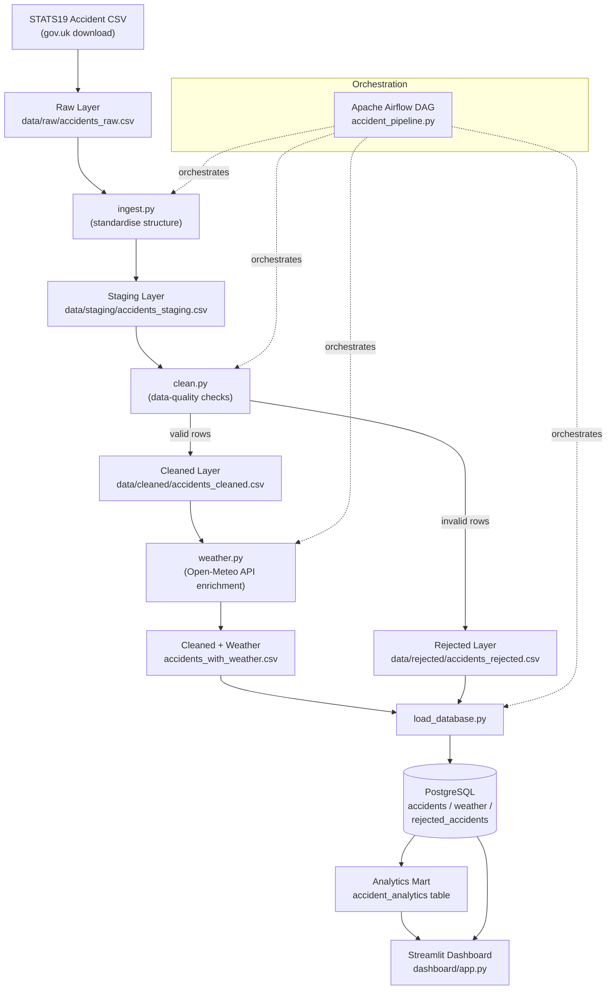

# Architecture Diagram — Traffic Accident Severity Analytics (Part 1)



## How to view/export this diagram
- **In VS Code**: install the "Markdown Preview Mermaid Support" extension, then open this file
  and use `Ctrl+Shift+V` to preview it rendered.
- **Online**: paste the code block content (without the ```mermaid fences) into
  https://mermaid.live to view and export as PNG/SVG for your report.
- **GitHub**: this file renders automatically if you push it to a GitHub repository.

## Layer-by-layer explanation (for your report/viva)

| Layer | Purpose |
|---|---|
| **Raw** | Untouched copy of the source data, exactly as downloaded. Never modified. |
| **Staging** | Structurally standardised (column names, whitespace) but not yet validated. |
| **Cleaned** | Only rows that passed every data-quality check. Safe to load into Postgres. |
| **Rejected** | Rows that failed one or more checks, kept with reasons for auditing. |
| **PostgreSQL** | Durable storage for cleaned accidents, weather, and rejected records. |
| **Analytics Mart** | Pre-aggregated summary table for fast dashboard queries. |
| **Airflow** | Orchestrates the four Python steps in order, with retry/logging/monitoring. |
| **Streamlit** | Interactive dashboard reading from PostgreSQL for end-user analysis. |
